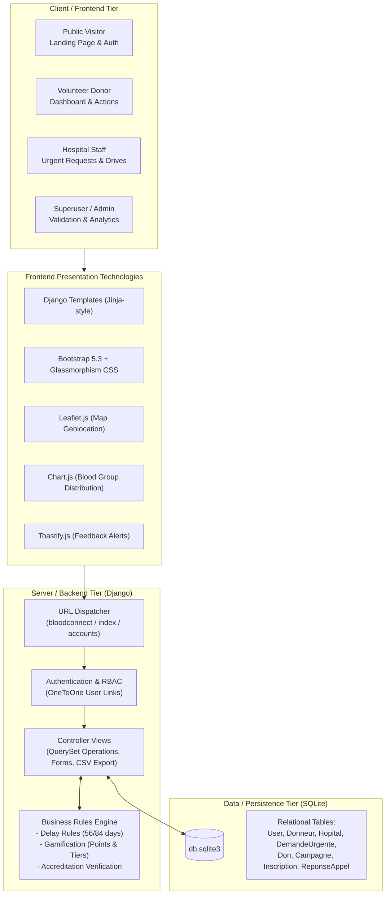
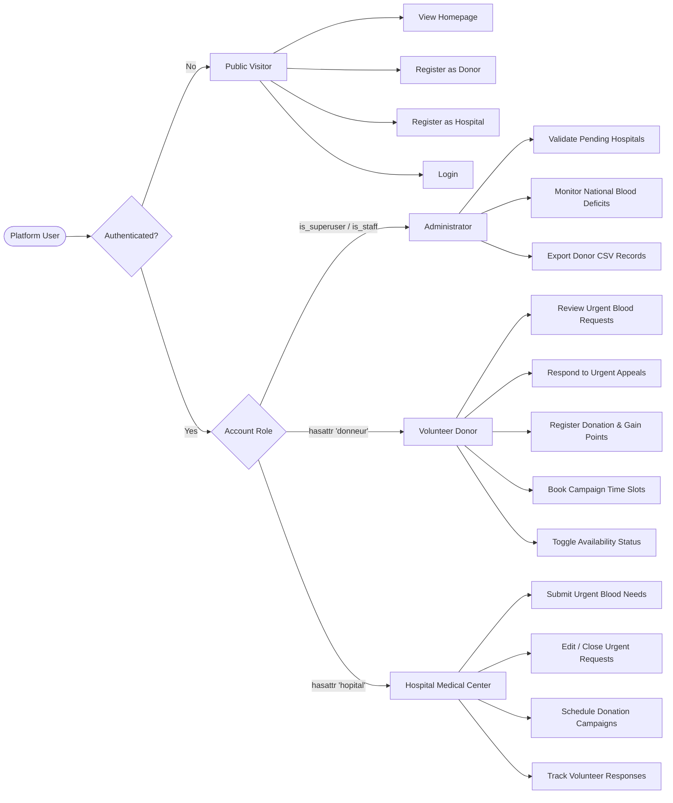

# BloodConnect Platform — System Architecture & Workflows

Welcome to the comprehensive workflow documentation for the **BloodConnect Platform**. This repository section details the architectural designs, process lifecycles, and data interactions across the **Frontend**, **Backend**, and **Database** tiers.

---

## 📑 Workflow Documentation Index

| Document | Focus Area | Description |
| :--- | :--- | :--- |
| **[1. Frontend Workflow](./frontend-workflow.md)** | Client-side Presentation & UX | Page inheritance, UI navigation journeys for Donors, Hospitals, and Admins, dynamic components (Leaflet, Chart.js, Toastify). |
| **[2. Backend Workflow](./backend-workflow.md)** | Server Logic & Business Rules | Django MVT request-response lifecycle, authentication & RBAC, eligibility calculations (56/84 days), points engine, validation gates. |
| **[3. Database Workflow](./database-workflow.md)** | Data Models & Relational Schemas | Complete Entity-Relationship (ER) diagram, table schemas, foreign key relationships, model lifecycle state machines. |
| **[4. Full-Stack Integration Workflow](./full-stack-integration-workflow.md)** | End-to-End System Interactions | Unified sequence diagrams tracking requests from UI triggers through backend processing down to database commits. |

---

## 🏛️ High-Level System Architecture

BloodConnect is built as an integrated, high-performance Django web application following the **Model-View-Template (MVT)** pattern.

---

## 👥 Core Personas & System Roles

---

## 🚀 Quick Reference Guide

- **Server Root**: `http://127.0.0.1:8001/`
- **Admin Gateway**: `http://127.0.0.1:8001/admin/`
- **Donor Hub**: `http://127.0.0.1:8001/dashboard/donneur/`
- **Hospital Hub**: `http://127.0.0.1:8001/dashboard/hopital/`
- **National Overview**: `http://127.0.0.1:8001/dashboard/admin/`
