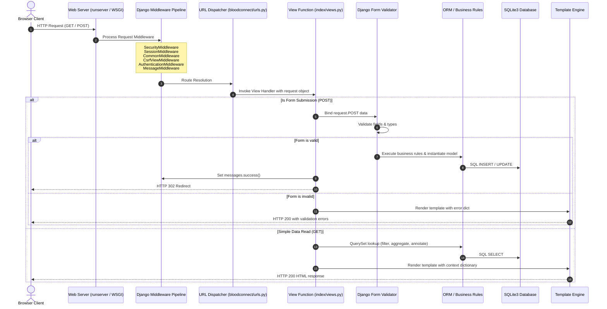
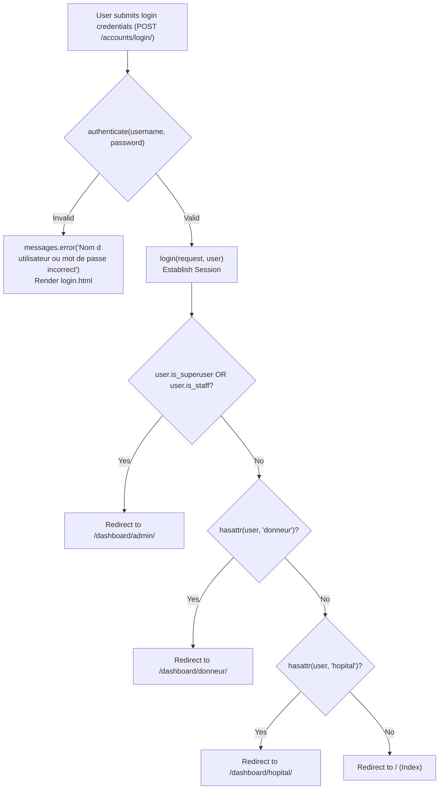
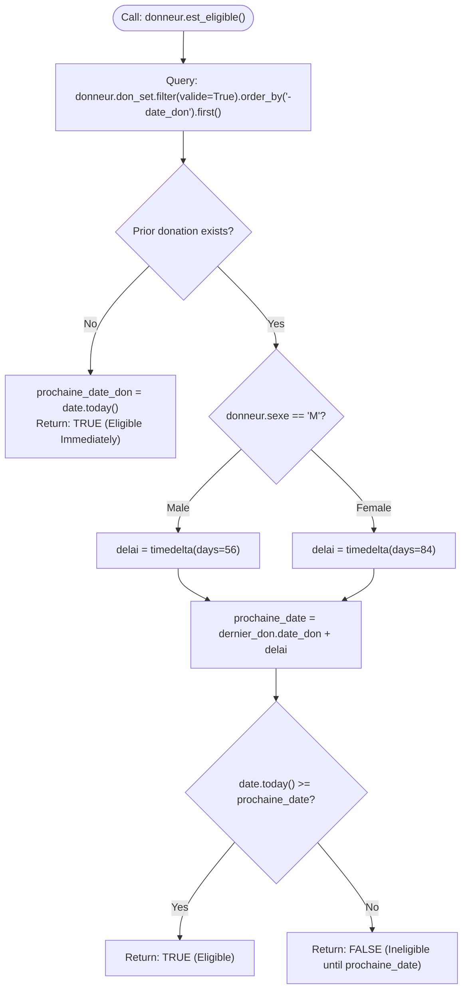
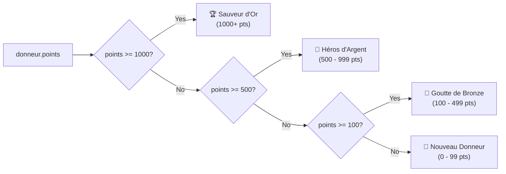
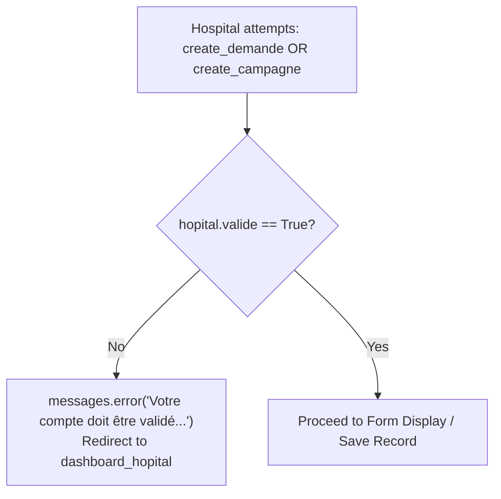

# Backend Workflow & Business Logic Architecture

## 1. Backend Architecture & Django Request Lifecycle

BloodConnect operates on a structured Django **Model-View-Template (MVT)** architecture. Incoming HTTP requests pass through Django's WSGI/ASGI handler, traverse configured middleware, hit the central URL dispatcher, and are executed inside view controllers.

---

## 2. Authentication & Role-Based Access Control (RBAC)

User identities are managed through Django's built-in `auth.User` model extended via **One-to-One Relationships** with domain-specific profiles (`Donneur` and `Hopital`).

### Role Determination in `login_view`

---

## 3. Core Business Logic Engines

### A. Donor Eligibility Calculation Engine

A donor cannot donate whenever they wish. Biological safety rules mandate strict intervals based on donor sex:
- **Men (`M`)**: 56 days minimum interval between donations (~8 weeks)
- **Women (`F`)**: 84 days minimum interval between donations (~12 weeks)

### B. Donor Gamification & Tier Engine

Donors earn points across three distinct platform interactions:
1. **+100 Points**: Registering a completed donation (`enregistrer_don`)
2. **+50 Points**: Booking a blood drive campaign slot (`inscrire_campagne`)
3. **+25 Points**: Responding to an urgent emergency request (`repondre_demande`)

Tiers are dynamically computed properties (`@property def niveau`):

### C. Hospital Accreditation Gatekeeper

To prevent spam or unverified requests, medical centers must be approved by an administrator before issuing emergency calls or scheduling campaigns:

### D. Campaign Capacity & Time-Slot Allocator

When a donor registers for a campaign (`inscrire_campagne`):
1. **Donor Eligibility Check**: Donor must satisfy `est_eligible()`.
2. **Duplicate Prevention**: Rejects if `Inscription.objects.filter(campagne=campagne, donneur=donneur).exists()`.
3. **Capacity Quota Check**: Ensures total registrations do not exceed `campagne.capacite_totale`.
4. **Time Slot Assignment**: Parses `request.POST.get('creneau')` into a `datetime.time` object.
5. **Reward**: Adds 50 points to the donor.

---

## 4. Complete Backend Route & View Matrix

| Route Pattern | View Function | Method | Auth Required | Purpose |
| :--- | :--- | :--- | :--- | :--- |
| `/` | `index` | `GET` | No | Public landing page |
| `/accounts/login/` | `login_view` | `GET, POST` | No | Authenticates and routes to role-specific dashboard |
| `/accounts/logout/` | `logout_view` | `GET` | No | Clears user session |
| `/accounts/register/donneur/` | `register_donneur` | `GET, POST` | No | Creates `User` + `Donneur` profile, auto-authenticates |
| `/accounts/register/hopital/` | `register_hopital` | `GET, POST` | No | Creates `User` + `Hopital` profile (`valide=False`) |
| `/dashboard/donneur/` | `dashboard_donneur` | `GET` | `@login_required` (Donor) | Donor metrics, eligibility status, active requests |
| `/profil/donneur/` | `profil_donneur` | `GET, POST` | `@login_required` (Donor) | Updates blood group, city, birth date, name, email |
| `/donneur/toggle-actif/` | `toggle_actif` | `GET` | `@login_required` (Donor) | Toggles active availability flag |
| `/donneur/enregistrer-don/` | `enregistrer_don` | `GET, POST` | `@login_required` (Donor) | Records validated donation (+100 pts) |
| `/dashboard/hopital/` | `dashboard_hopital` | `GET` | `@login_required` (Hospital) | Hospital requests, donor responses, campaigns |
| `/demande/nouvelle/` | `create_demande` | `GET, POST` | `@login_required` (Hospital) | Publishes new urgent blood request |
| `/demande/<id>/modifier/` | `edit_demande` | `GET, POST` | `@login_required` (Hospital) | Updates blood group, quantity, deadline |
| `/demande/<id>/cloturer/` | `close_demande` | `GET` | `@login_required` (Hospital) | Sets request status to `Clôturée` |
| `/demande/<id>/repondre/` | `repondre_demande` | `GET` | `@login_required` (Donor) | Submits response to emergency (+25 pts) |
| `/campagnes/` | `list_campagnes` | `GET` | `@login_required` | Displays all upcoming blood drives |
| `/campagne/nouvelle/` | `create_campagne` | `GET, POST` | `@login_required` (Hospital) | Creates public blood drive with capacity |
| `/campagne/<id>/inscrire/` | `inscrire_campagne` | `POST` | `@login_required` (Donor) | Books time slot (+50 pts) |
| `/dashboard/admin/` | `dashboard_admin` | `GET, POST` | `@login_required` (Admin) | Validates hospitals, shows analytics |
| `/admin/export-donneurs/` | `export_donneurs_csv` | `GET` | `@login_required` (Admin) | Streams UTF-8 BOM CSV export of all donors |
