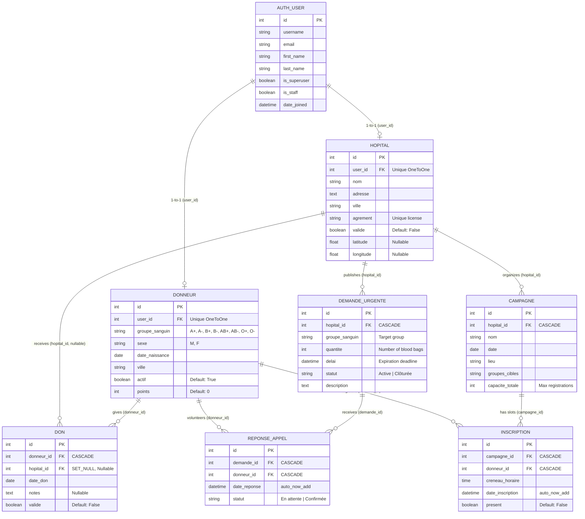
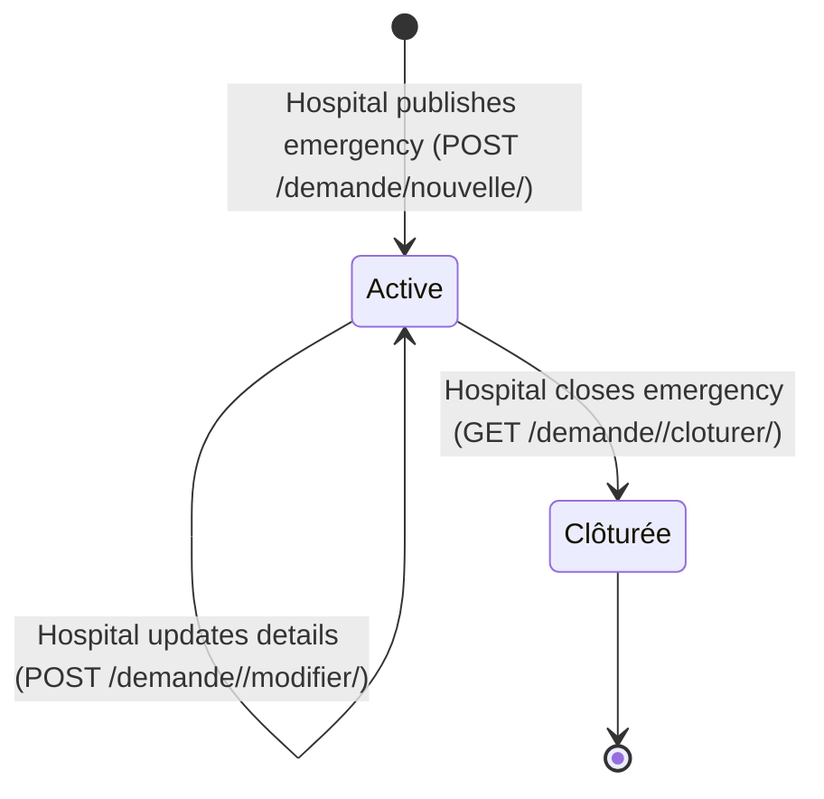
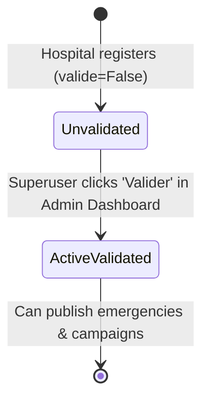
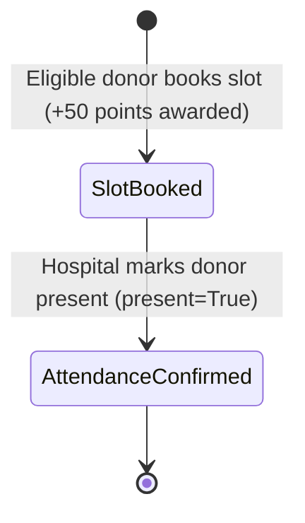

# Database Architecture, Schema & Data Flow Workflows

## 1. Database Architecture & Engine

BloodConnect utilizes Django's ORM mapped over an embedded **SQLite3** relational database (`db.sqlite3`). The relational schema ensures referential integrity, cascading updates, and constraints across all operational entities.

---

## 2. Complete Entity-Relationship (ER) Diagram

---

## 3. Data Dictionary & Table Definitions

### A. `Donneur` (Extended Donor Profile)
- **Table Name**: `index_donneur`
- **Relationship**: `OneToOneField(User, on_delete=models.CASCADE)`

| Field Name | Type | Nullable | Constraints / Choices | Description |
| :--- | :--- | :--- | :--- | :--- |
| `id` | BigAutoField | No | Primary Key | Internal donor ID |
| `user_id` | Integer | No | Unique, Foreign Key (`auth_user.id`) | Links to base authentication account |
| `groupe_sanguin`| CharField(3) | No | `A+`, `A-`, `B+`, `B-`, `AB+`, `AB-`, `O+`, `O-` | Donor blood group |
| `sexe` | CharField(1) | No | `M` (Homme), `F` (Femme) | Biological gender determining donation wait period |
| `date_naissance`| DateField | No | None | Date of birth |
| `ville` | CharField(100) | No | None | Residential city |
| `actif` | BooleanField | No | Default: `True` | Availability toggle to receive notifications |
| `points` | PositiveInteger | No | Default: `0` | Accumulated reward points |

**Computed Properties**:
- `niveau`: Returns `"Sauveur d'Or"` (>= 1000), `"Héros d'Argent"` (>= 500), `"Goutte de Bronze"` (>= 100), or `"Nouveau Donneur"` (< 100).
- `prochaine_date_don()`: Finds the latest validated `Don` and adds 56 days (if `sexe == 'M'`) or 84 days (if `sexe == 'F'`).
- `est_eligible()`: Checks whether `date.today() >= self.prochaine_date_don()`.

---

### B. `Hopital` (Medical Center Profile)
- **Table Name**: `index_hopital`
- **Relationship**: `OneToOneField(User, on_delete=models.CASCADE)`

| Field Name | Type | Nullable | Constraints | Description |
| :--- | :--- | :--- | :--- | :--- |
| `id` | BigAutoField | No | Primary Key | Internal hospital ID |
| `user_id` | Integer | No | Unique, Foreign Key (`auth_user.id`) | Associated login credentials |
| `nom` | CharField(200) | No | None | Official hospital/clinic name |
| `adresse` | TextField | No | None | Physical street address |
| `ville` | CharField(100) | No | None | Municipal city |
| `agrement` | CharField(100) | No | Unique | Official state accreditation number |
| `valide` | BooleanField | No | Default: `False` | Administrative approval flag |
| `latitude` | FloatField | Yes | None | Geospatial latitude for map display |
| `longitude` | FloatField | Yes | None | Geospatial longitude for map display |

---

### C. `DemandeUrgente` (Emergency Blood Request)
- **Table Name**: `index_demandeurgente`
- **Relationship**: `ForeignKey(Hopital, on_delete=models.CASCADE)`

| Field Name | Type | Nullable | Constraints / Choices | Description |
| :--- | :--- | :--- | :--- | :--- |
| `id` | BigAutoField | No | Primary Key | Urgent request ID |
| `hopital_id` | Integer | No | Foreign Key (`index_hopital.id`) | Requesting hospital |
| `groupe_sanguin`| CharField(3) | No | Choices: Blood Groups | Required blood category |
| `quantite` | PositiveInteger | No | None | Number of blood bags required |
| `delai` | DateTimeField | No | None | Expiration deadline for emergency |
| `statut` | CharField(20) | No | Default: `Active`, Choices: `Active`, `Clôturée` | Current status of request |
| `description` | TextField | No | None | Medical context, ward, patient priority |

---

### D. `Don` (Donation Event Record)
- **Table Name**: `index_don`

| Field Name | Type | Nullable | Constraints | Description |
| :--- | :--- | :--- | :--- | :--- |
| `id` | BigAutoField | No | Primary Key | Donation record ID |
| `donneur_id` | Integer | No | Foreign Key (`index_donneur.id`, CASCADE) | Donor who performed donation |
| `hopital_id` | Integer | Yes | Foreign Key (`index_hopital.id`, SET_NULL) | Hospital where donation took place |
| `date_don` | DateField | No | None | Date of actual blood extraction |
| `notes` | TextField | Yes | None | Clinical or doctor notes |
| `valide` | BooleanField | No | Default: `False` | Verification status |

---

### E. `Campagne` (Blood Drive Campaign)
- **Table Name**: `index_campagne`

| Field Name | Type | Nullable | Description |
| :--- | :--- | :--- | :--- |
| `id` | BigAutoField | No | Campaign record ID |
| `hopital_id` | Integer | No | Organizing hospital (`CASCADE`) |
| `nom` | CharField(200) | No | Title of blood drive campaign |
| `date` | DateField | No | Scheduled date |
| `lieu` | CharField(200) | No | Venue / address of collection point |
| `groupes_cibles`| CharField(100) | No | Comma-separated target groups (e.g., `O-, A+`) |
| `capacite_totale`| PositiveInteger| No | Total available booking slots |

---

### F. `Inscription` (Campaign Slot Registration)
- **Table Name**: `index_inscription`

| Field Name | Type | Nullable | Description |
| :--- | :--- | :--- | :--- |
| `id` | BigAutoField | No | Registration record ID |
| `campagne_id` | Integer | No | Target campaign (`CASCADE`) |
| `donneur_id` | Integer | No | Registered donor (`CASCADE`) |
| `creneau_horaire`| TimeField | No | Selected appointment time |
| `date_inscription`| DateTimeField| No | Timestamp created (`auto_now_add=True`) |
| `present` | BooleanField | No | Attendance confirmation (Default: `False`) |

---

### G. `ReponseAppel` (Urgent Request Response)
- **Table Name**: `index_reponseappel`

| Field Name | Type | Nullable | Constraints / Choices | Description |
| :--- | :--- | :--- | :--- | :--- |
| `id` | BigAutoField | No | Primary Key | Response ID |
| `demande_id` | Integer | No | Foreign Key (`index_demandeurgente.id`, CASCADE) | Emergency being answered |
| `donneur_id` | Integer | No | Foreign Key (`index_donneur.id`, CASCADE) | Responding volunteer donor |
| `date_reponse` | DateTimeField | No | `auto_now_add=True` | Timestamp when donor pledged |
| `statut` | CharField(20) | No | Default: `En attente`, Choices: `En attente`, `Confirmée` | Status of donor arrival |

---

## 4. Entity Lifecycle State Machines

### Emergency Request (`DemandeUrgente`) State Flow

### Hospital Accreditation (`Hopital.valide`) State Flow

### Campaign Registration (`Inscription`) Lifecycle

