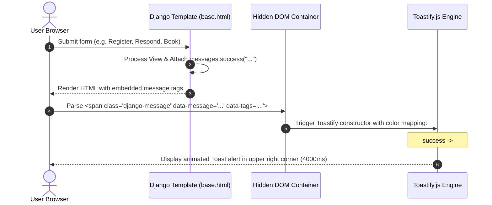
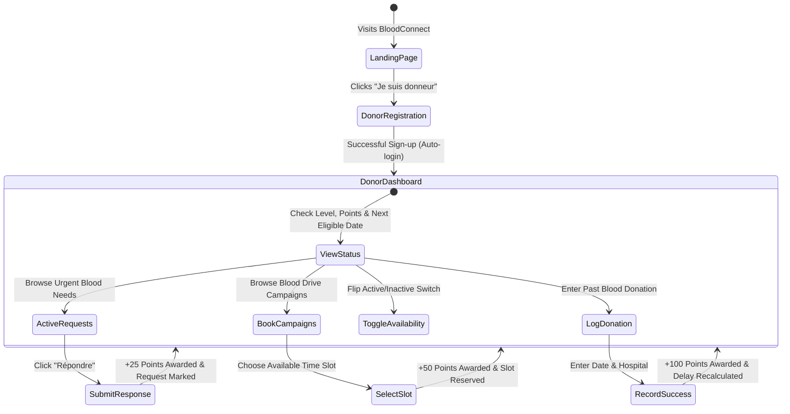
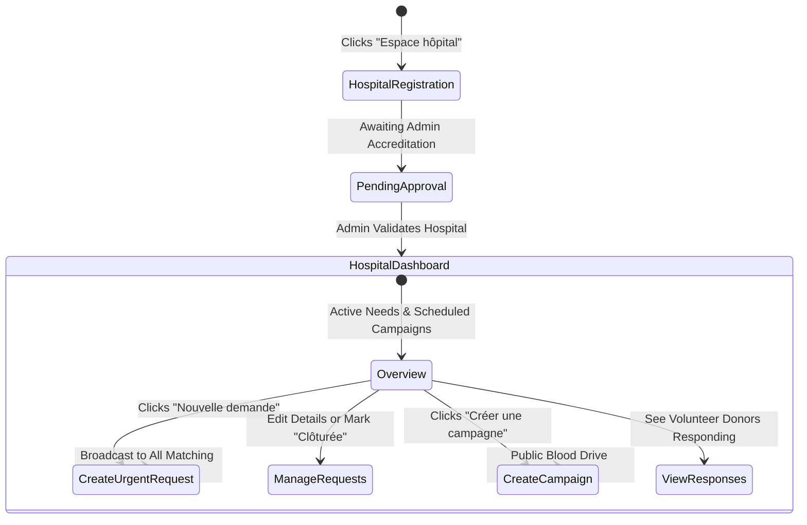
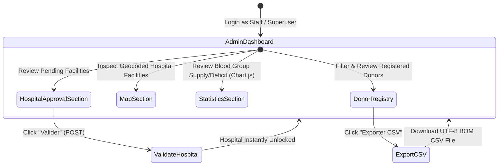

# Frontend Workflow & User Experience Architecture

## 1. Frontend Technology Stack

The BloodConnect frontend is engineered for responsive, high-contrast, accessible design with glassmorphic aesthetics.

| Layer | Technology | Purpose |
| :--- | :--- | :--- |
| **Templating Engine** | Django Template Language (DTL) | Server-Side Rendering (SSR) of dynamic views, conditional layouts, and CSRF token injection |
| **CSS Framework** | Bootstrap 5.3.0 + Custom CSS | Responsive layout grid, modern utilities, and custom glassmorphism design (`static/css/style.css`) |
| **Iconography** | Bootstrap Icons 1.10.5 | Visual indicators for statuses, metrics, navigation, and badges |
| **Notification Engine** | Toastify.js | Client-side reactive toast alerts populated from Django's backend message framework |
| **Mapping Engine** | Leaflet.js 1.9.4 | Interactive OpenStreetMap integration plotting hospital coordinates and regional centers |
| **Data Visualization** | Chart.js | Dynamic bar and doughnut charts visualizing real-time blood deficit distributions |

---

## 2. Template Architecture & Inheritance Hierarchy

The frontend uses a unified master layout (`base.html`) providing the persistent navigation bar, brand assets, footer, and automated notification handling script.

```mermaid
flowchart TD
    Base["base.html<br/>• Glassmorphism Navbar<br/>• Dynamic Role Links<br/>• Toastify Message Engine<br/>• Footer"]

    Base --> Index["index/index.html<br/>• Hero Section<br/>• Mission Statement<br/>• Registration CTAs"]
    Base --> AuthGroup["accounts/ Templates"]
    Base --> DonorGroup["Donor Views (index/)"]
    Base --> HospGroup["Hospital Views (index/)"]
    Base --> AdminGroup["Admin Views (index/)"]

    AuthGroup --> Login["accounts/login.html"]
    AuthGroup --> RegDonor["accounts/register_donneur.html"]
    AuthGroup --> RegHosp["accounts/register_hopital.html"]

    DonorGroup --> DashDonor["index/dashboard_donneur.html<br/>• Donor Tier Badge & Points<br/>• Next Eligible Date Indicator<br/>• Active Urgent Requests<br/>• Booked Campaigns List"]
    DonorGroup --> ProfileDonor["index/profil_donneur.html<br/>• Personal Info & Blood Group"]
    DonorGroup --> RecordDon["index/enregistrer_don.html<br/>• Self-reported Donation Entry"]
    DonorGroup --> ListCamp["index/list_campagnes.html<br/>• Blood Drive Schedule & Time-slot Selector"]

    HospGroup --> DashHosp["index/dashboard_hopital.html<br/>• Active Blood Requests<br/>• Donor Responses Feed<br/>• Campaign Schedules"]
    HospGroup --> CreateDemande["index/create_demande.html<br/>• Blood Group, Quantity, Deadline"]
    HospGroup --> EditDemande["index/edit_demande.html"]
    HospGroup --> CreateCamp["index/create_campagne.html<br/>• Date, Place, Target Groups, Quota"]

    AdminGroup --> DashAdmin["index/dashboard_admin.html<br/>• Accreditation Verification Panel<br/>• Leaflet Hospital Map<br/>• Chart.js Blood Group Stats<br/>• CSV Export Trigger"]
```



---

## 3. Global Notification & Toast Notification Workflow

Django sends flash messages (`messages.success`, `messages.error`, `messages.warning`, `messages.info`) during view redirects. The frontend captures these in an invisible DOM container and dynamically converts them to animated Toastify notifications on DOM load.



---

## 4. Persona User Journeys & Screen Transitions

### A. Volunteer Donor User Journey



### B. Hospital Staff User Journey



### C. Platform Administrator User Journey



---

## 5. Client-Side Interactive Components

### Leaflet.js Hospital Geospatial Map
On `dashboard_admin.html`, Leaflet initializes a dark/light tile layer and evaluates embedded hospital records:
```javascript
// Initializes center on national coordinates
const map = L.map('map').setView([36.8065, 10.1815], 7);
// Iterates through hospital queryset and drops custom markers
// displays popup with hospital name, accreditation number, and validation badge
```

### Chart.js Blood Group Deficit Visualization
On `dashboard_admin.html`, Chart.js reads aggregated active emergency requests:
```javascript
new Chart(ctx, {
    type: 'bar',
    data: {
        labels: ['O+', 'A+', 'B+', 'AB+', 'O-', 'A-', 'B-', 'AB-'],
        datasets: [{ label: 'Demandes Actives', data: [...] }]
    }
});
```
