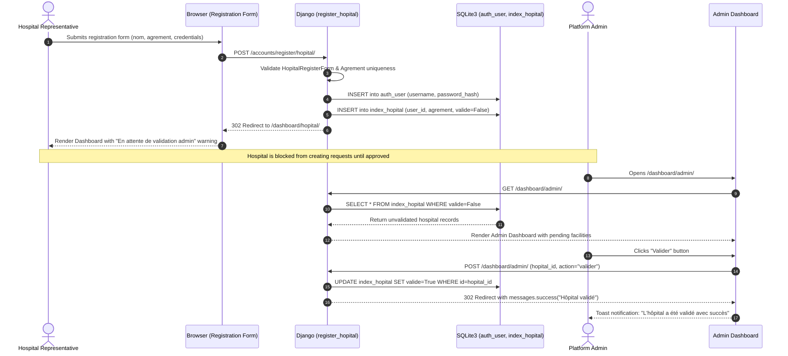
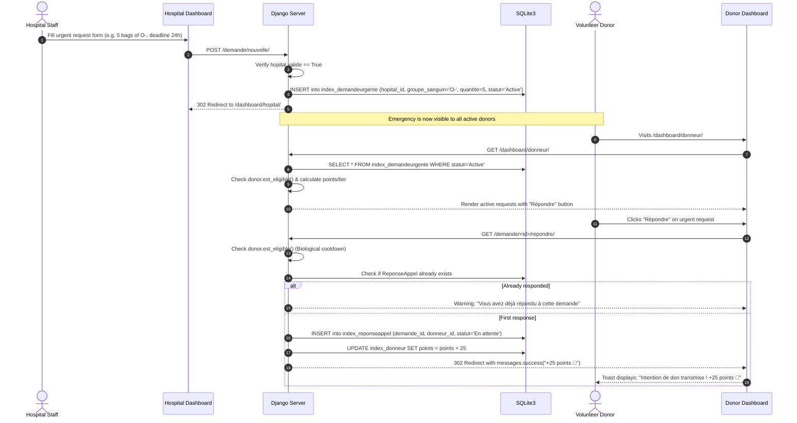
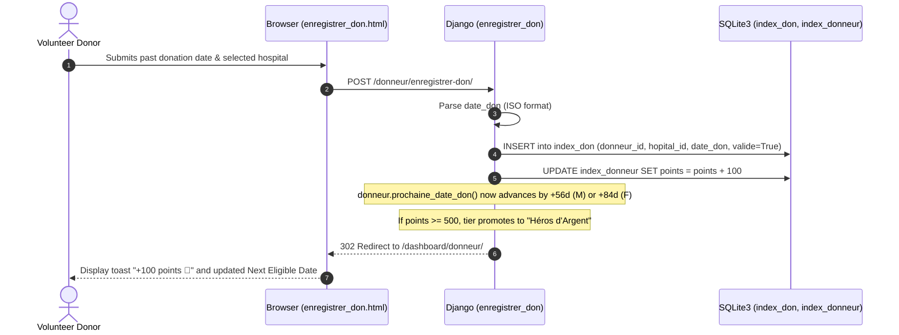
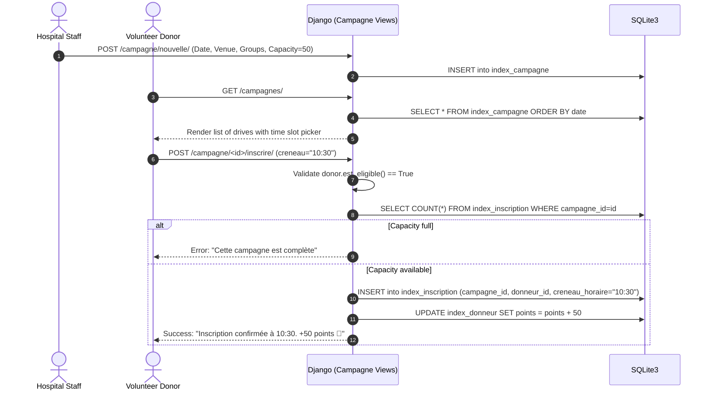

# Full-Stack Integration Workflows

This document illustrates the end-to-end operational workflows connecting user actions in the **Frontend**, processing in the **Backend**, and persistence in the **Database**.

---

## 1. Scenario 1: Hospital Registration & Admin Approval Workflow

A new hospital joins the platform and must be vetted by an administrator before posting urgent requests.

---

## 2. Scenario 2: Urgent Blood Request & Donor Response Workflow

A verified hospital posts a critical shortage of blood bags, and an eligible donor volunteers.

---

## 3. Scenario 3: Blood Donation Logging & Tier Promotion Workflow

A donor records a validated blood donation, triggering cooldown recalculations and badge promotions.

---

## 4. Scenario 4: Blood Drive Campaign Booking Workflow

A hospital schedules a collection drive, and an eligible donor reserves a time slot.

---

## 5. Cross-Tier Interaction Matrix

| User Action | Client-Side Trigger | Server View Function | Database Mutations | Client Response / Viewport Update |
| :--- | :--- | :--- | :--- | :--- |
| **Donor Registration** | Form Submit on `register_donneur.html` | `accounts.views.register_donneur` | `INSERT auth_user`, `INSERT index_donneur` | Auto-login & redirect to Donor Dashboard |
| **Hospital Registration** | Form Submit on `register_hopital.html` | `accounts.views.register_hopital` | `INSERT auth_user`, `INSERT index_hopital` (`valide=False`) | Redirect to Hospital Dashboard with pending alert |
| **Approve Hospital** | "Valider" click on `dashboard_admin.html` | `index.views.dashboard_admin` | `UPDATE index_hopital SET valide=True` | Toast alert, hospital status badge changes to Green |
| **Publish Urgent Need** | Form Submit on `create_demande.html` | `index.views.create_demande` | `INSERT index_demandeurgente` | Request appears on Hospital & Donor Dashboards |
| **Volunteer for Need** | "Répondre" button click | `index.views.repondre_demande` | `INSERT index_reponseappel`, `UPDATE index_donneur (+25 pts)` | Toast notification, button changes to "Répondu" |
| **Close Urgent Need** | "Clôturer" button click | `index.views.close_demande` | `UPDATE index_demandeurgente SET statut='Clôturée'` | Request moves to closed requests section |
| **Log Donation** | Form Submit on `enregistrer_don.html` | `index.views.enregistrer_don` | `INSERT index_don`, `UPDATE index_donneur (+100 pts)` | Cooldown reset (+56/84 days), +100 pts toast |
| **Book Campaign Slot**| Time slot selection & Submit | `index.views.inscrire_campagne`| `INSERT index_inscription`, `UPDATE index_donneur (+50 pts)`| Slot booked confirmation toast, +50 pts badge |
| **Toggle Availability**| Availability switch click | `index.views.toggle_actif` | `UPDATE index_donneur SET actif = NOT actif` | Status badge toggles between Active and Inactive |
| **Export Donor CSV** | "Exporter CSV" button click | `index.views.export_donneurs_csv`| None (Read-only `SELECT`) | Browser initiates file download `donneurs_bloodconnect.csv` |
